# Ghost Jump

**Die on purpose. Climb on your own ghosts.**

Ghost Jump is a one-tap 2D puzzle platformer made in Unity 6. The character runs by itself and the
only thing you control is when it jumps. Every death leaves the body frozen where it died, as a
platform for the next attempt, so failing is how you solve a level.

**[▶ Play in your browser](https://alihamxamalik.github.io/Ghost-Jump-Game/)**
&nbsp;·&nbsp;
**[Download for Android](https://github.com/Alihamxamalik/Ghost-Jump-Game/releases/latest/download/GhostJump.apk)** (APK, 34 MB)

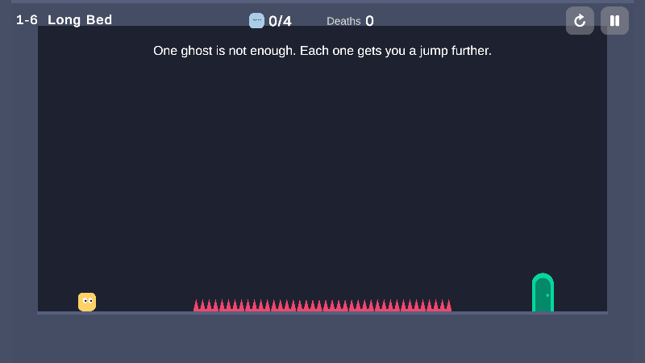

*Level 1-6, "Long Bed". Two deaths leave two ghosts, and the third run hops across them.*

## Contents

- [Play it](#play-it)
- [Screenshots](#screenshots)
- [How it plays](#how-it-plays)
- [Level elements](#level-elements)
- [Levels](#levels)
- [Game feel](#game-feel)
- [Phones, tablets and browsers](#phones-tablets-and-browsers)
- [How it's built](#how-its-built)
- [What's next](#whats-next)

## Play it

| Platform | How |
|----------|-----|
| **Browser** | [alihamxamalik.github.io/Ghost-Jump-Game](https://alihamxamalik.github.io/Ghost-Jump-Game/) in Chrome, Edge, Firefox or Safari on a computer, or on a phone held sideways. Progress is saved in the browser. |
| **Android** | [GhostJump.apk](https://github.com/Alihamxamalik/Ghost-Jump-Game/releases/latest/download/GhostJump.apk) from the [latest release](https://github.com/Alihamxamalik/Ghost-Jump-Game/releases/latest). Android 6.0 or newer, on a 64-bit phone. |

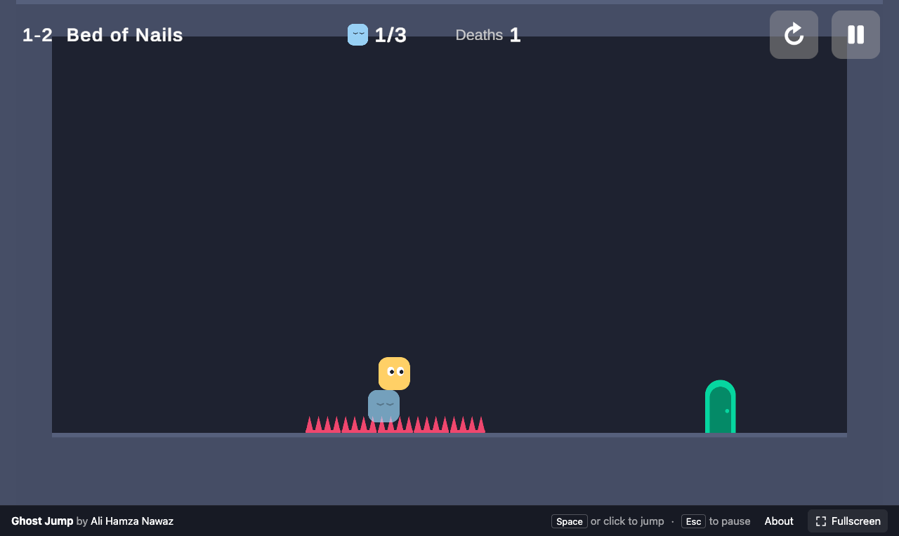

| Input                          | Action |
|--------------------------------|--------|
| Tap, click or Space            | Jump   |
| Esc, or Back on Android        | Pause  |

**Installing the APK.** Open the downloaded file on the phone. The first time, Android asks you to
allow installs from your browser or file manager. Allow it, then tap Install. The game isn't on
Google Play, so Play Protect may say it doesn't recognise the developer and offer to scan the app
first.

This repository holds the playable builds and the media on this page. The Unity project itself is
kept in a separate, private repository.

## Screenshots

| | |
|---|---|
| 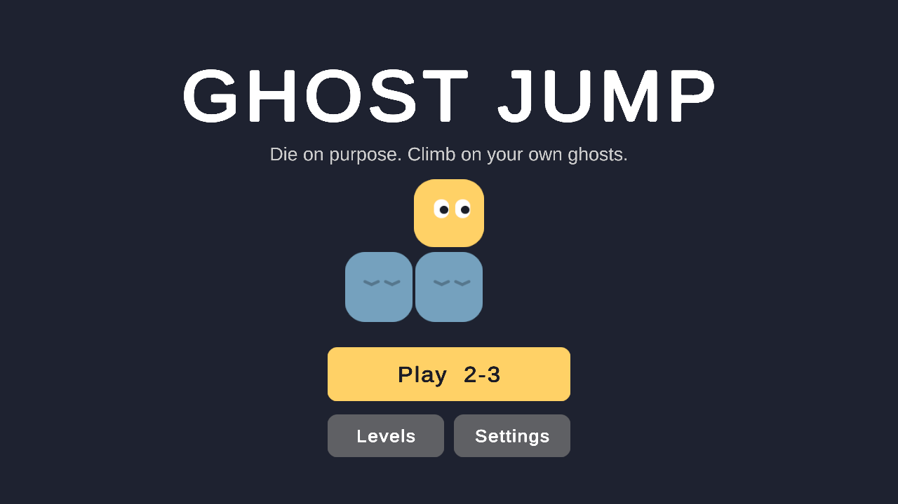 | 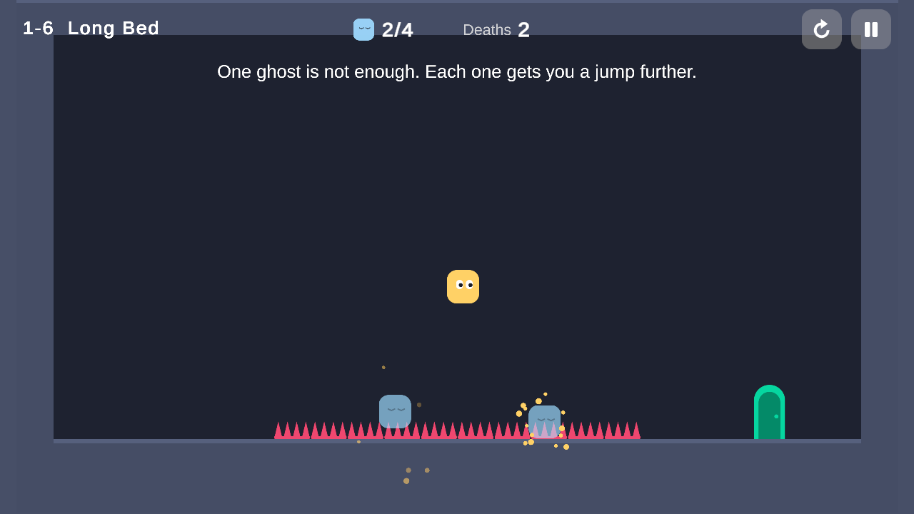 |
| 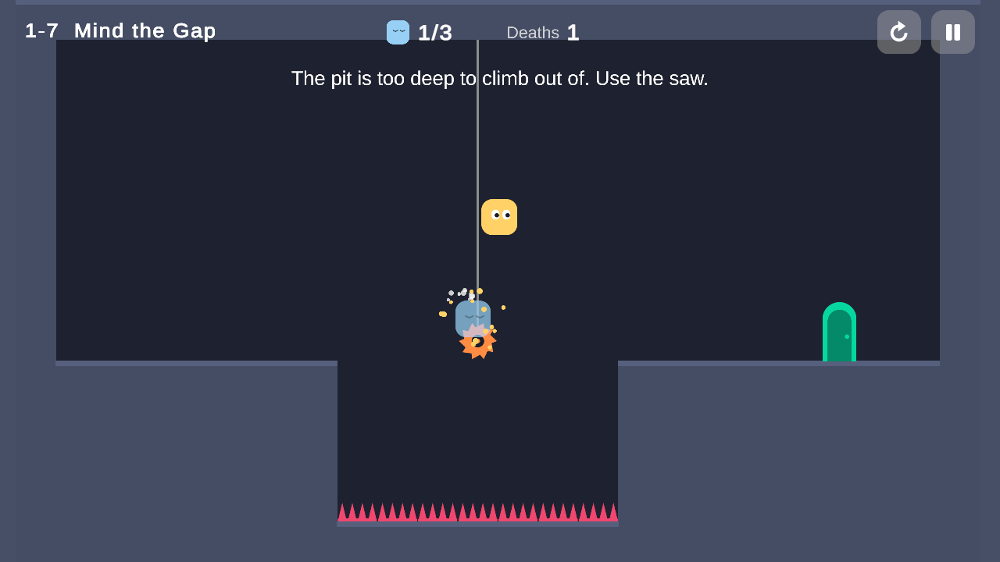 | 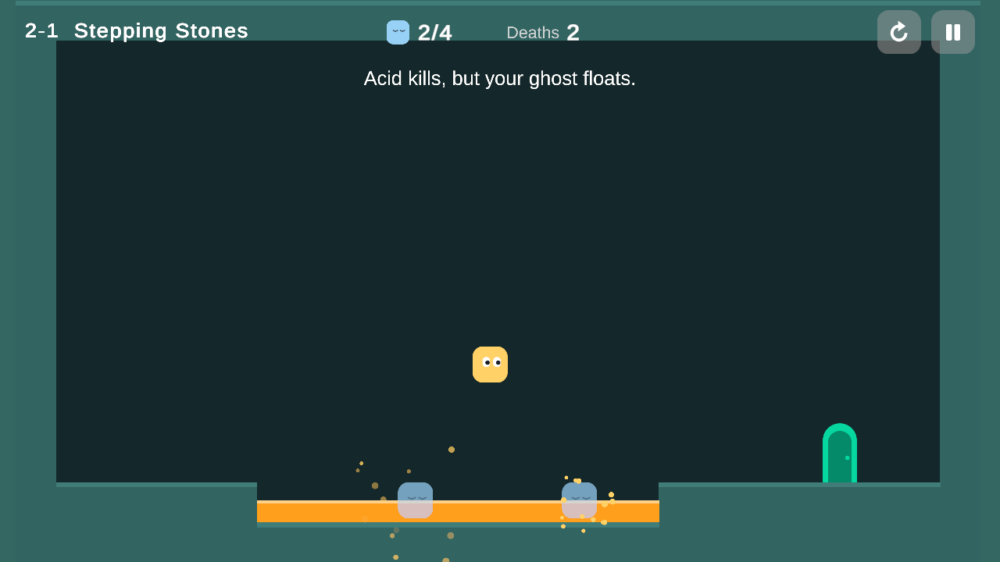 |
| 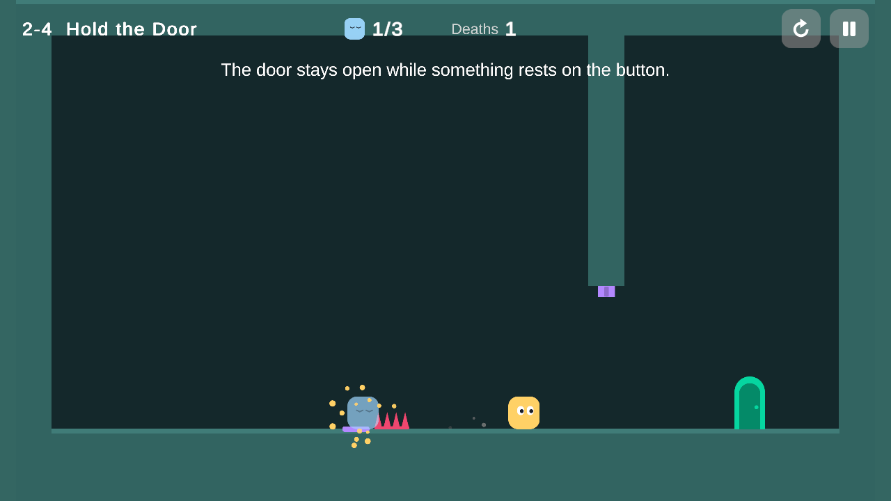 | 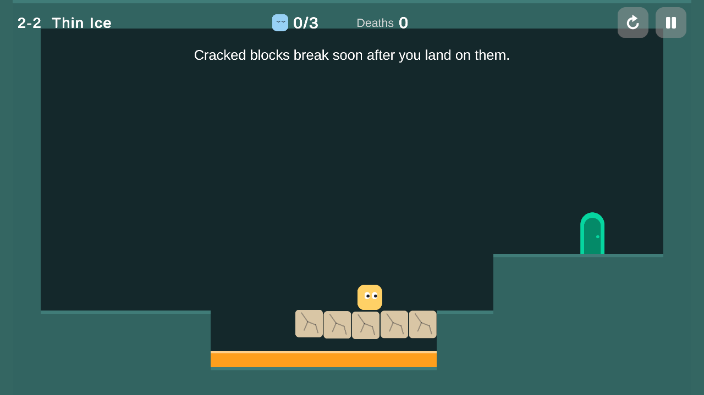 |
| 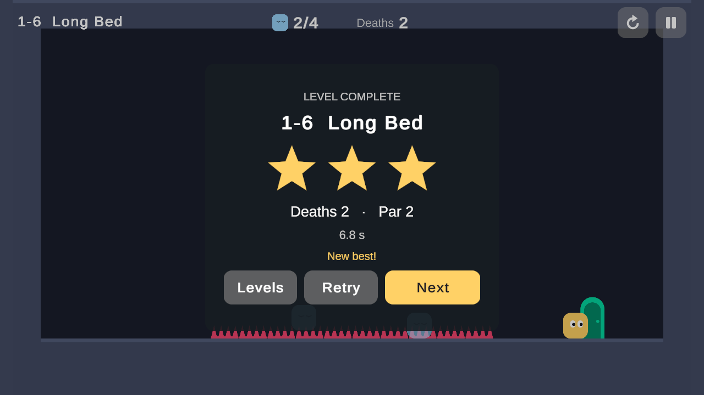 | 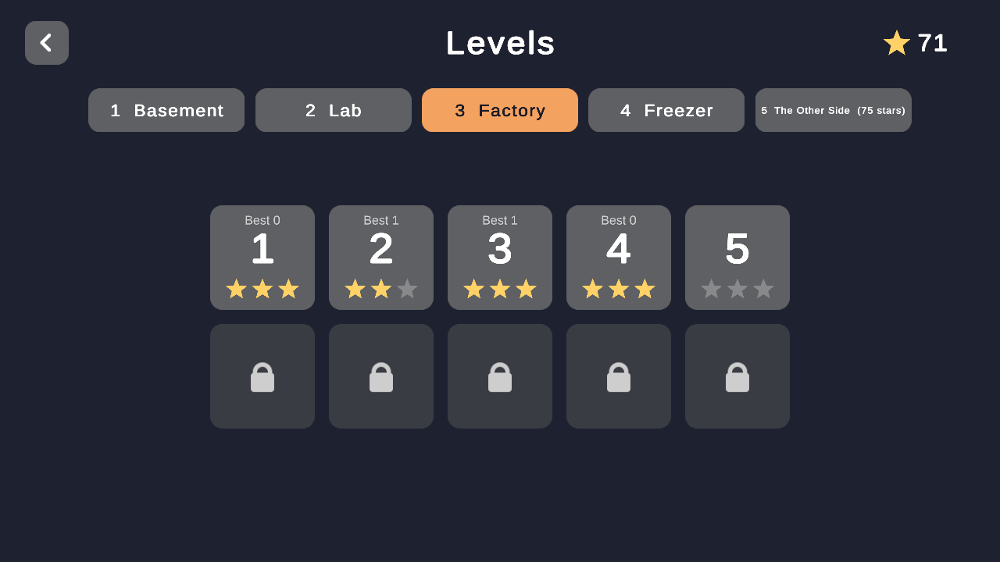 |
| 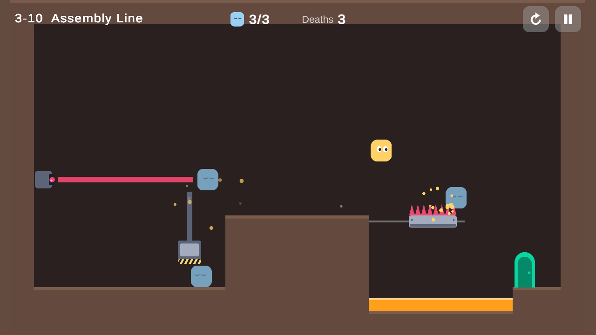 | 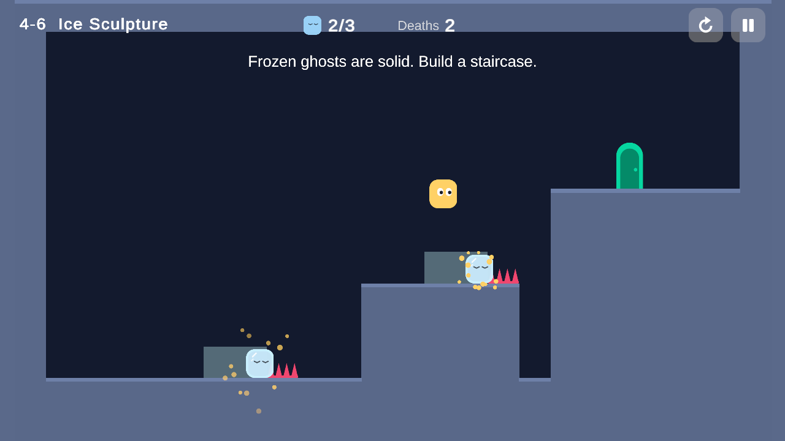 |
| 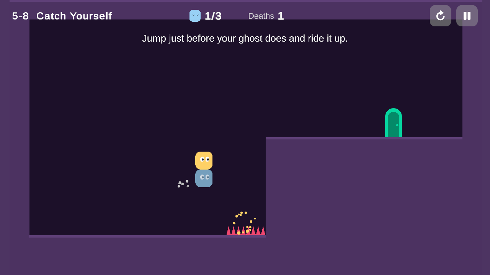 | 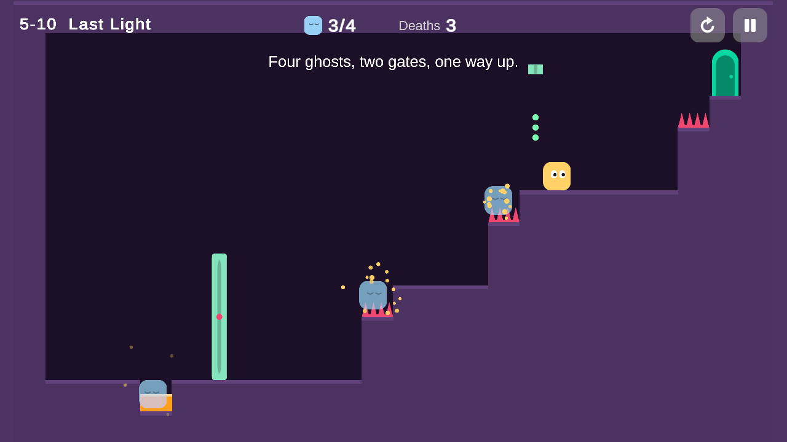 |
| 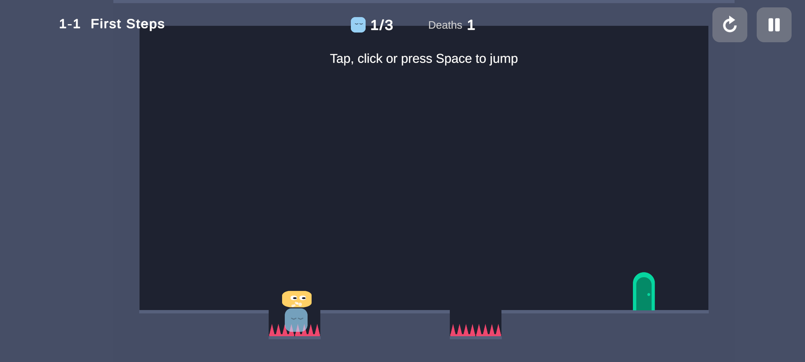 | 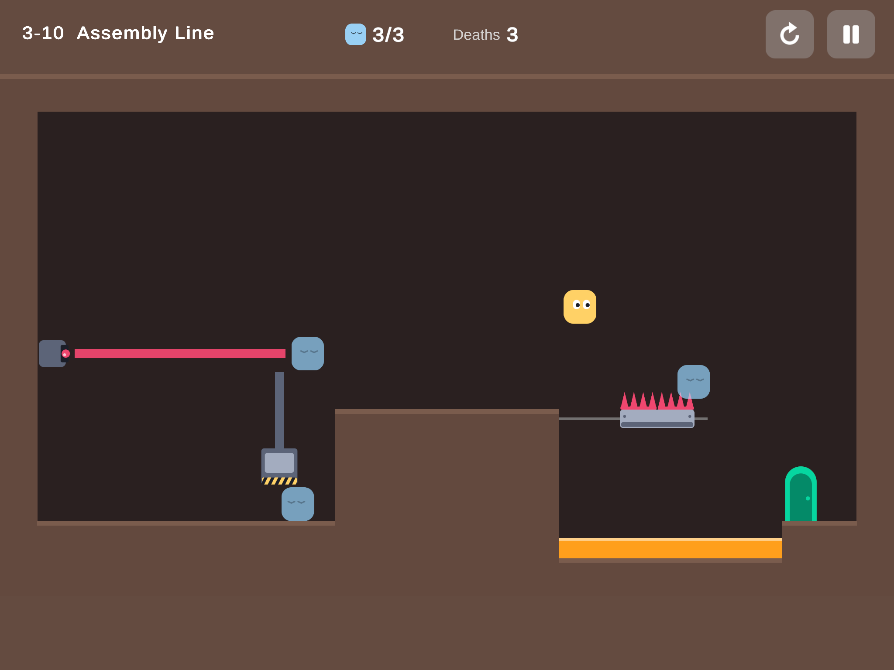 |

## How it plays

- **One input.** Tap, click or press Space to jump. There is nothing else to press.
- **The runner never stops.** It moves at a constant speed and turns around when it hits a wall.
- **Hazards kill instantly.** The body freezes at the exact spot where it died and becomes a ghost:
  translucent, blue, eyes closed.
- **Ghosts are one-way platforms.** You pass through them from below and from the sides, and land
  on top.
- **Instant retry.** The runner is back at the start 0.3 seconds later. The ghosts stay.
- **Ghosts are limited.** Each level allows between 1 and 4. Dying past the limit removes the oldest one.
- **Restart** clears every ghost and resets the death count.

Reaching the exit finishes the level. Stars compare your deaths with the level's par, the fewest
deaths it can be finished with.

| Stars | Rule               |
|-------|--------------------|
| 3     | Deaths ≤ par       |
| 2     | Deaths ≤ par + 2   |
| 1     | Level completed    |

That is the tension the game is built on: you need ghosts to win, and every extra one costs a star.

Levels unlock in order inside a world. World 2 opens at 15 stars, World 3 at 35, World 4 at 55 and
World 5 at 75, so one-star clears are not enough to see everything.

## Level elements

Each element is there because it changes what a ghost is good for.

| Element                | World | What it does                                    | What a ghost does with it                                  |
|------------------------|-------|-------------------------------------------------|------------------------------------------------------------|
| Spikes                 | 1     | Kill on touch                                   | Rests on top of them, a step you can land on               |
| Hanging saw            | 1     | Kills on touch, fixed in the air                | Freezes in mid-air on it and becomes a floating step       |
| Acid pool              | 2     | Kills on touch                                  | Floats on the surface, level with the banks                |
| Pressure button + door | 2     | The door is open only while the button is held  | A ghost left on the button holds the door open for good    |
| Crumbling block        | 2     | Breaks half a second after you land on it       | A ghost resting on it is lost when it breaks               |
| Moving platform        | 3     | Carries the runner back and forth on a track    | Rides along as a moving step                               |
| Laser                  | 3     | A beam that kills on touch, steady or blinking  | Plugs it: the beam stops at the ghost                      |
| Press                  | 3     | Slams down on a timer                           | Jams it. The press rests on the ghost and its top is a step |
| Frost                  | 4     | Freezes whatever dies in it                     | A frozen ghost is a solid wall that turns the runner around |
| Icicle                 | 4     | Drops when the runner comes near                | Catches it like an umbrella                                |
| Spirit gate            | 5     | Open only while exactly N ghosts exist          | Every death changes the count, so it can open or shut      |
| Haunting               | 5     | The runner comes back on its newest ghost       | Each death moves the start, even into mid-air              |
| Echo                   | 5     | A ghost that replays your last run each attempt | Holds buttons, and you can ride it up its own jump         |

Hazards are red and orange and ghosts are cool blue, so danger and help read at a glance.

## Levels

Each level is one screen with the whole puzzle visible from the start. The first level of a world
shows a new element, the next ones require it, and later levels mix it with earlier ones. Par is in
brackets.

| #  | 1 Basement       | 2 Lab               | 3 Factory          | 4 Freezer          | 5 The Other Side       |
|----|------------------|---------------------|--------------------|--------------------|------------------------|
| 1  | First Steps (0)  | Stepping Stones (2) | Night Shift (0)    | Brain Freeze (1)   | Head Count (2)         |
| 2  | Bed of Nails (1) | Thin Ice (0)        | Ferry (1)          | Detour (1)         | One Too Many (3)       |
| 3  | Leg Up (1)       | Deep End (1)        | Firewall (1)       | Switchback (2)     | Haunted (1)            |
| 4  | Too High (1)     | Hold the Door (1)   | Blink (0)          | Icicle Alley (0)   | Inchworm (3)           |
| 5  | U-Turn (0)       | Lab Rat (2)         | Crossbeam (1)      | Umbrella (1)       | Point of No Return (2) |
| 6  | Long Bed (2)     | Trapdoor (0)        | Wedge (1)          | Ice Sculpture (2)  | Déjà Vu (1)            |
| 7  | Mind the Gap (1) | Double Lock (2)     | Jam (1)            | Pinball (2)        | Relay (2)              |
| 8  | Two Flights (2)  | Last Ghost (3)      | Catch the Bus (2)  | Cold Storage (2)   | Catch Yourself (1)     |
| 9  | Sawmill (0)      | No Footing (1)      | Two Birds (1)      | Black Ice (2)      | Afterimage (3)         |
| 10 | Last Step (2)    | Musical Chairs (3)  | Assembly Line (3)  | Avalanche (3)      | Last Light (4)         |

## Game feel

- Squash and stretch on every jump and landing, with a puff of dust.
- On death: 80 ms of hit-stop, a short screen shake, and the body flashes white before it settles
  into the ghost tint.
- The respawn pops in with a quick scale-up.
- The HUD ghost counter bounces when it changes.
- On level complete: confetti, then the stars pop in one by one, each a little higher in pitch.
- A **Juice** toggle in settings switches all of it off, to compare the game with and without it.

All of this lives in one script, and the toggle disables that script's effects and nothing else.

## Phones, tablets and browsers

The game is landscape on every device, and nothing in it assumes a 16:9 screen.

- **The UI always fits.** Every screen is laid out on a 1920x1080 canvas that is always shown in
  full: a 20:9 phone adds width around it and a 4:3 tablet adds height.
- **Notches and camera cutouts.** The game draws behind a cutout, but every screen's content keeps
  clear of it and follows it to the other side when the phone is turned round, and the camera fits
  the level beside it.
- **Thumb-sized targets.** The HUD's restart and pause buttons also take taps just outside their
  edges, and each settings row toggles from anywhere along it.
- **60 frames a second.** Phones default to 30, which is too few for a timing game.
- **Back pauses** the game, and a death gives a short vibration (Settings > Vibration turns it off).
- **In a browser** the game fills the window at any size, with a fullscreen button, and asks a phone
  held upright to turn sideways.

## How it's built

| | |
|---|---|
| Engine    | Unity 6 (6000.0.81f1), 2D URP 17 |
| Packages  | Input System, 2D Tilemap with Rule Tiles, TextMesh Pro, Unity Test Framework |
| Platforms | Android (IL2CPP, ARM64) and WebGL |
| Code      | About 3,000 lines of game code, 3,300 of editor tooling and 950 of tests. No third-party plugins |

### One scene, data-driven levels

There are three scenes: `Boot` loads the save, `MainMenu` holds the menu and level select, and
`Game` plays every level. A level is a prefab described by a `LevelData` ScriptableObject (id, name,
prefab, ghost limit, par, hint, and whether the level is haunted or has echoes), and a
`LevelDatabase` lists them in order together with the worlds, their colours and their star gates.
Moving to the next level swaps one prefab; no scene is reloaded.

### One death event

`PlayerDeath` raises a single `Died(position, hazard)` event. Three listeners react to it and know
nothing about each other, and only `GameManager` talks to the UI, the save file and the level data.

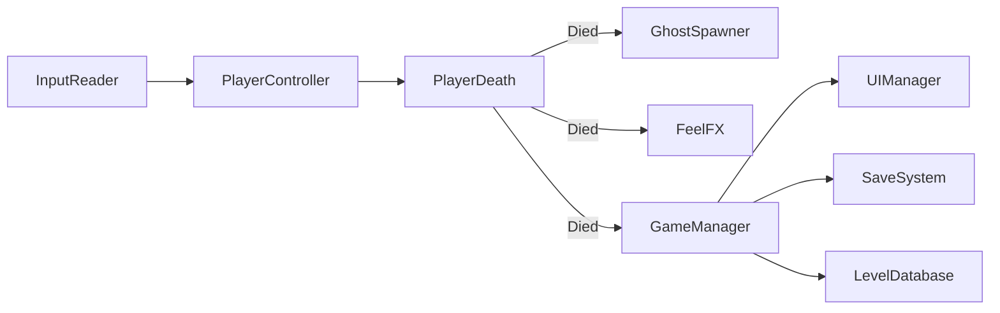

### Making ghosts behave

When the runner touches a hazard, it stops and the death event carries the body's exact physics
position. The ghost spawner turns that into a ghost: on acid it floats on the surface, in a laser it
settles in the middle of the beam and plugs it, in frost it freezes solid, and on a moving platform
it rides along. Everything else freezes exactly where it died.

<details>
<summary>The spawner, in code</summary>

```csharp
public Ghost Spawn(Vector2 deathPos, Hazard hazard)
{
    // Acid: the body floats on the surface. A laser: it settles in the middle of the beam,
    // plugging it. Everything else: it freezes exactly where it died.
    if (hazard.Type == HazardType.Acid)
    {
        deathPos.y = hazard.SurfaceY;
    }
    else if (hazard.Type == HazardType.Laser)
    {
        LaserGate laser = hazard.GetComponentInParent<LaserGate>();
        if (laser != null) deathPos = laser.CenterLine(deathPos);
    }

    if (ghosts.Count >= limit)
    {
        ghosts[0].Dismiss(Juice);
        ghosts.RemoveAt(0);
    }

    Ghost ghost = Instantiate(ghostPrefab, deathPos, Quaternion.identity, transform);

    if (FreezeField.Overlaps(new Rect(deathPos - bodySize * 0.5f, bodySize)))
        ghost.Freeze();

    // Echoes move along their own recorded path, so only still ghosts ride platforms.
    MovingPlatform carrier = echoes ? null : PlatformUnder(deathPos);
    if (carrier != null) ghost.transform.SetParent(carrier.transform, true);

    ghosts.Add(ghost);
    CountChanged?.Invoke(ghosts.Count, limit);
    return ghost;
}
```

</details>

A few details make ghosts behave the way a player expects:

- **One-way platform.** A ghost is a static `BoxCollider2D` with a `PlatformEffector2D`. Its arc is
  just short of a half circle, so a runner that clips the top corner is still caught and carried
  over instead of falling through.
- **A little wider than the body.** Repeating the jump that killed you reaches the ghost's top
  slightly before the spot where you died. The platform is 1.1 tiles wide against a 0.8 body, which
  is what makes "do the same jump again" land on it.
- **Ground check.** The runner casts a thin box down against the Ground and Ghost layers. Hits at
  distance zero are ghosts it is currently passing through, so they don't count, and nothing counts
  while the runner is rising faster than the surface under it. Without those two rules a ghost would
  give a free second jump. Measuring against the surface is what lets a rising platform, or a rising
  echo, carry the runner up.
- **Moving surfaces.** Platforms, press heads and echoes report their velocity. On a platform the
  runner runs at its usual speed relative to the platform. An echo moves at the runner's own pace,
  so it only lifts the runner and never carries it sideways.
- **Buttons poll.** Two static colliders never raise trigger messages, so a pressure button checks
  an overlap box every physics step. That is also why a ghost that is removed releases the button
  without any extra bookkeeping.

### Movement

The jump is tuned in designer units and the physics is derived from them: gravity and launch speed
come from `jumpHeight` (2.5 tiles) and `timeToApex` (0.36 s), with 1.5 times the gravity on the way
down for a snappier fall. The launch speed includes half a step of compensation for the way the
physics engine integrates, so the apex is exactly the configured height, and a test checks it.
Coyote time and the jump buffer are 0.1 s each.

### Levels are text files

Levels are authored as small text layouts and turned into Tilemap prefabs by an editor tool. This is
all of level 1-2:

```
name: Bed of Nails
par: 1
ghosts: 3
hint: Dying leaves a ghost behind. Land on it.
solution: R6.5 ; R6.5 G
---
########################
#......................#
#......................#
#......................#
#......................#
#......................#
#......................#
#......................#
#......................#
#......................#
#......................#
#.P.....^^^^^......E...#
########################
########################
```

The generated prefabs are ordinary Unity content: a Tilemap with a Rule Tile and a composite
collider, plus nested prefab instances for hazards, buttons and doors, so they can still be opened
and edited by hand.

### Every level is proven solvable

The `solution:` line in a layout is not a comment. A play mode test loads each level, lets a bot
replay the solution against the real physics, and fails if the level isn't finished with exactly
its par number of deaths. If a level or the jump tuning changes in a way that breaks a level, the
test for that level goes red.

The suite has 74 play mode tests:

- **50 level tests**, one per level, as described above.
- **11 gameplay tests**: the ghost freezes at the exact death position, the respawn takes under
  half a second, the ghost limit, restart, pause, the two crumbling-block rules, the flow from boot to
  the first level, and input. The input tests press a virtual mouse and a virtual touchscreen: a
  press on empty space must jump, and a press on the pause button must pause and never jump.
- **8 mechanic tests**, one for each new element: a ghost rides a moving platform, plugs a laser,
  jams a press, freezes into a wall and catches an icicle; a spirit gate opens only at its exact
  count; a haunted runner comes back on its newest ghost; and an echo replays its run, then holds a
  button where it died.
- **2 screen tests**: the UI and the level both keep clear of a phone's camera cutout.
- **3 progression tests**: the star rule, saving and reloading, and the unlock rules.

### Generated art and audio

The art and audio are placeholders generated by editor code: sprites are drawn from signed-distance
shapes, and the sound effects and music loops are synthesised straight to WAV. One menu command
rebuilds the art, audio, prefabs, levels and scenes, and others build the APK and the web version.

## What's next

- A Google Play release.
- A 30-second playable ad cut from the same project.
- Final art and audio in place of the generated placeholders.

## Author

Made by **Ali Hamza Nawaz**. More work at [alihamzanawaz.vercel.app](https://alihamzanawaz.vercel.app).
